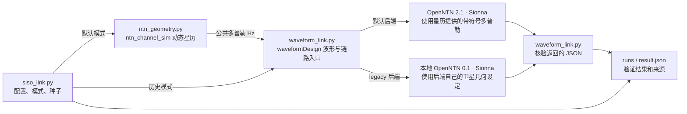

# 实验平台架构

平台把现有项目的能力组合成可复验的实验。首个入口完成一条 SISO 链路。它从动态星历取一个时刻的公共多普勒，再用同一组符号和同一个信道实现运行普通 CP-OFDM 与加窗 OFDM。两种波形的传播由 OpenNTN 和 Sionna 提供，收发与指标计算复用 `waveformDesign`。平台约定和验收范围见 [EXPERIMENT_PLATFORM.md](EXPERIMENT_PLATFORM.md)。

## 模块和数据流

| 模块 | 输入 | 职责与输出 |
| --- | --- | --- |
| [`siso_link.py`](../src/experiment_platform/experiments/siso_link.py) | 上游项目路径、后端选择、载频、采样率、信道类型、块数、种子。默认模式另接收星历场景配置和仿真时间。 | 解析参数、选择实验路径、登记源码身份并按顺序调用两个接入模块。生成独立的运行目录和 `result.json`。 |
| [`ntn_geometry.py`](../src/experiment_platform/experiments/ntn_geometry.py) | NTN 检出路径、YAML、仿真时间（s）、波形载频（Hz）。 | 调用 `NTNChannelSimulator` 的公开快照接口。返回带符号的公共多普勒（Hz）、公共传播时延（s）、距离（m）、仰角（°）、可见性、差分核验及文件身份。 |
| [`waveform_link.py`](../src/experiment_platform/experiments/waveform_link.py) | 波形检出路径、载频和采样率（Hz）、NTN-TDL 类型、种子、块数。默认模式接收公共多普勒（Hz），历史模式接收本地 OpenNTN 检出路径。 | 调用上游 `openntn` Pixi 任务并解析 JSON。核对实际参数、后端版本、抽头索引、输出长度、配对诊断和同种子复验，返回完整链路摘要。 |

父进程使用 Python 标准库。NTN 和波形入口分别在各自锁定的 Pixi 环境内运行，跨进程交换 JSON 摘要。波形项目的原始符号、波形采样和信道矩阵在其链路进程内计算和核验。平台保存实际参数、数据形状、时延和诊断计数作为运行证据。

## 后端与启用方式

| 路径 | 现有组件与工作分配 | 验证含义 |
| --- | --- | --- |
| 默认模式 | `ntn_channel_sim` 提供星历几何。调用方提供可访问的 `waveformDesign`，复用它的波形、接收流程及 OpenNTN 适配。OpenNTN 2.1.0 提供 NTN-TDL 和指定的公共频移，Sionna 2.0.1 将连续路径响应转换为离散时变抽头。 | 验证从实际星历快照到波形链路的入参和时间约定。 |
| `--openntn-root` | 复用 `waveformDesign` 的 `legacy` 后端和调用方提供的本地 OpenNTN 0.1.0 源码及锁定环境。卫星多普勒沿用旧模型自身的几何输入和计算。 | 独立记录为历史链路复现检查，专门核验旧入口、传播输出和同种子复验。 |

`--ntn-root` 与 `--openntn-root` 二选一。提供 `--ntn-root` 时可以指定 `--ntn-config` 和 `--time-s`，并需准备 NTN 默认环境和波形项目的 `default`、`openntn21` Pixi 环境。提供 `--openntn-root` 时，波形项目的默认环境调用本地 OpenNTN 环境。运行命令见 [README](../README.md)。

## 采样、相位和校验

1. `ntn_geometry.py` 确认 NTN 子进程实际导入指定检出代码，并要求动态星历、可见快照和一致载频。设公共传播时延为 `τ(t)`，以 `−f_c · dτ/dt` 核对快照多普勒的符号和大小。步长为 10 ms，有足够历史时用中心差分，靠近零时用二阶前向差分。容许偏差为 0.05 Hz。
2. 默认模式只向波形链路传入几何摘要中的公共多普勒。载频来自共同配置，波形采样率由波形参数指定。频移在一帧内取常值，由 OpenNTN 施加一次。公共时延留在几何记录里，波形传播使用相对路径时延，抽头时间零点按首径对齐。
3. 上游用同一批 QPSK 符号和同一信道生成两种波形结果，保留完整时域输出。每块有 128 个有用样本和 16 个 CP 样本，共 96 个活动子载波。若输入长度为 `N`，离散抽头索引范围是 `[l_min, l_max]`，则抽头数为 `L = l_max − l_min + 1`，完整输出长度为 `N + L − 1`。接收器从输出索引 `−l_min` 读取 `N` 个首径对齐的样本。
4. 同种子复验由波形入口重新生成信道，并比较抽头数组、路径时延、时间原点和实现来源。平台在返回摘要上检查复验状态、两种波形输出长度和符号计数，记录原始错误数与输出能量。原始错误数来自均衡前接收，仅用于链路诊断。

## 运行记录与扩展

`runs/<run_id>/result.json` 保存请求参数、有效链路配置、种子、实际检出提交和工作区状态。可用时同时保存锁文件 SHA-256。两条路径都属于 `interface_validation`，实验名分别为 `siso_ephemeris_openntn_link` 与 `siso_legacy_openntn_link`。默认模式附星历和 NTN YAML 哈希，以及快照核验结果。波形记录附后端库版本、实际信道实现和参数表哈希，以及输出时间范围和配对诊断。

历史 OpenNTN 源码如果以没有独立 Git 元数据的子模块目录提供，记录运行时使用的实现与参数表哈希，以及父仓库登记的子模块指针。实际运行的源码提交仍为未知。每次运行新建目录。若记录显示工作区有本地改动，复跑还需要取得当时实际使用的改动。

- 研究星历辅助时，从当前几何接口出发为接收机独立构造可获得的辅助观测及误差，将真值保留在实验层。先验证时间、相位和辅助信息口径，再接入补偿器、参考接收机和配对统计。
- 扩展到其他平台时，先让新链路复现一个有可核验输入、时间原点和输出支持的 SISO 用例。准备比较通信收益时，在协议中登记相同输入、信道实现或配对随机源、接收机信息和资源约束。
- 另一个实验实际需要相同的身份登记或 JSON 文件工具时，再将它们提取到 `unit/`。有明确图表需求时，从已保存的运行记录生成 `reports/`，并记录图表使用的运行 ID。
